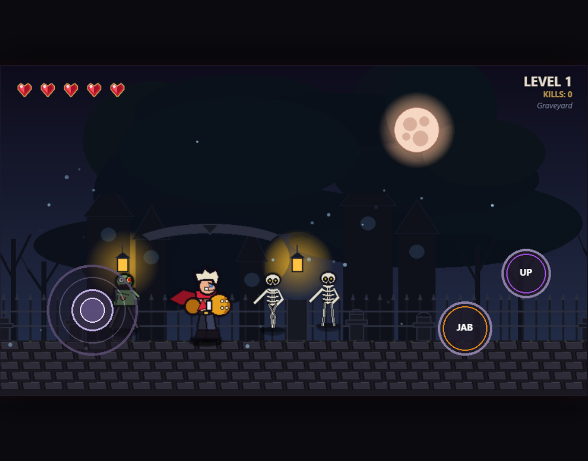
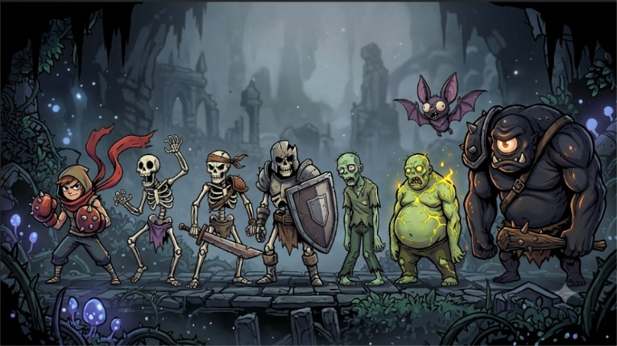
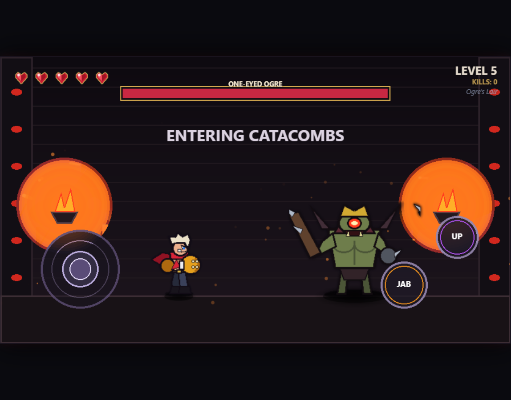
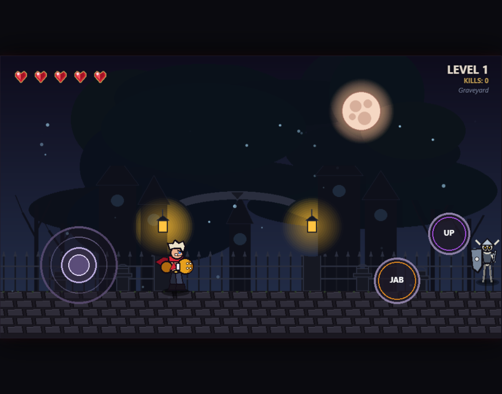

# FLIP THE SWITCH

### An Endless Dark-Fantasy 2D Beat-'Em-Up

<p align="center">
  <strong>FIGHT. SURVIVE. ADAPT.</strong><br>
  An endless battle against the creatures of a gothic world.
</p>

<p align="center">
  
  
  
  
</p>

---

## About the Game

**Flip The Switch** is an endless 2D beat-'em-up where players fight through waves of increasingly dangerous enemies in a dark-fantasy world.

Play as a lone fighter with two primary attacks: a fast straight punch and a powerful uppercut. Defeat enemies, earn kills, level up, encounter new enemy variants and survive increasingly difficult boss encounters.

There is no final victory screen. **Your objective is simple: survive as long as possible.**

## Key Features

- **Dynamic combat:** Straight punches, uppercuts, directional aiming and responsive hitboxes.
- **Enemy variety:** Skeletons, zombies, aerial bats and a powerful boss.
- **Distinct enemy mechanics:** Shield blocking, explosive deaths, aerial swoops and unpredictable boss attacks.
- **Progressive difficulty:** Enemy health, damage, spawn rates and concurrent limits scale over time.
- **Boss encounters:** Dedicated arenas with multiple attack patterns.
- **Gothic environments:** Parallax backgrounds, atmospheric zones and boss arenas.
- **Endless gameplay:** Five player health points, restartable runs and no artificial victory condition.
- **Responsive controls:** Virtual joystick and attack buttons alongside desktop keyboard controls.

## Gameplay Showcase

The following screenshots were captured directly from the running game:

<p align="center">
  
  
</p>

<p align="center">
  
  
</p>

The gameplay, boss-fight and HUD images were captured from the running game. The character sheet is the supplied project artwork.

---

## Gameplay Mechanics

### Player Combat

| Attack | Desktop key | Damage | Description |
| --- | --- | ---: | --- |
| Straight punch | `J` | 1 | Fast forward attack |
| Uppercut | `K` | 2 | Strong upward attack |

Directional input allows the player to aim attacks higher. Holding up while attacking performs a higher-directed strike.

### Enemy Variants

| Enemy | Special mechanic |
| --- | --- |
| Unarmed Skeleton | Basic melee attacker |
| Sword Skeleton | Increased durability and attack reach |
| Sword & Shield Skeleton | Blocks frontal punches; uppercut breaks the guard |
| Normal Zombie | Standard melee enemy |
| Blast Zombie | Explodes after a delay when defeated |
| Bat | Aerial enemy vulnerable to timed uppercuts |
| One-Eyed Ogre | Periodic boss with multiple attack patterns |

### Boss Encounters

The One-Eyed Ogre appears approximately every five levels in an isolated boss arena. Its attacks include:

- Long-range club attacks
- Laser-eye attacks
- Ground slams
- Grabs
- Sweeping club attacks

### Difficulty Progression

- Enemy health and damage increase with level.
- Concurrent enemy limits increase.
- Stronger variants become more common.
- Boss health increases between encounters.

### Endless Survival

- Starting health: 5 HP
- Temporary invulnerability after taking damage
- Game over when health reaches zero
- Restartable runs for a longer survival time
- No conventional victory condition

---

## Technical Architecture

The game uses HTML5 Canvas and vanilla JavaScript. Input handling, player logic, enemy behaviour, world rendering and the main game loop are separated into focused modules.

```text
                  FLIP THE SWITCH
                         |
                    index.html
                         |
                      main.js
                         |
          +--------------+--------------+
          |              |              |
        Input          Player          World
          |              |              |
       Keyboard       Movement        Parallax
       Joystick       Combat          Zones
       Buttons        Health          Boss Arena
          |              |              |
          +--------------+--------------+
                         |
                      Enemies
                         |
          +--------------+--------------+
          |              |              |
       Skeletons       Zombies          Bat
          |              |              |
          +--------------+--------------+
                         |
                    Wave Manager
                         |
                  Level Progression
                         |
                     Ogre Boss
                         |
                   Canvas Renderer
```

### Technology Stack

| Technology | Purpose |
| --- | --- |
| HTML5 | Application structure |
| CSS3 | UI styling and layout |
| JavaScript | Gameplay and game logic |
| HTML5 Canvas | Real-time 2D rendering |
| Git and GitHub | Version control and collaboration |
| Switch | Multi-agent orchestration |

### Core Modules

| Module | Responsibility |
| --- | --- |
| [`main.js`](game/main.js) | Game loop, state management and rendering |
| [`input.js`](game/src/input.js) | Keyboard, joystick and button input |
| [`player.js`](game/src/player.js) | Player movement, combat and health |
| [`enemies.js`](game/src/enemies.js) | Enemy AI, variants, attacks and spawning |
| [`world.js`](game/src/world.js) | World rendering, scrolling and zones |

---

## Built with Switch

### Multi-Agent Game Development

Flip The Switch was developed using **Switch** to coordinate specialized AI agents through a shared GameForge room and GitHub repository.

| Agent | Primary responsibility |
| --- | --- |
| Producer | Planning, milestones and coordination |
| Designer | Game design, specifications and visual direction |
| Developer | Implementation and integration |
| QA | Testing, defect reports and verification |

The shared project context included:

- [`GAME_BRIEF.md`](GAME_BRIEF.md) for the initial game concept
- [`GDD.md`](GDD.md) for detailed gameplay specifications
- [`tests/acceptance-checklist.md`](tests/acceptance-checklist.md) for acceptance criteria
- `production/bug-reports/` for defect documentation

The workflow was specification-driven: the designer defined the systems, the producer coordinated dependencies, the developer implemented them and QA independently verified the result.

### Development Milestones

| Milestone | Implementation |
| --- | --- |
| T0 | Initial game scaffold and Canvas setup |
| T1 | Player movement, joystick, punches and hitboxes |
| T2 | Health, damage, game over and endless mode |
| T3 | Enemy framework, wave spawning and leveling |
| T4 | Skeleton variants and shield blocking |
| T5 | Normal and explosive zombie variants |
| T6 | Bat enemy with uppercut-only vulnerability |
| T7 | One-Eyed Ogre boss and isolated arena |
| T8 | Progressive difficulty scaling |
| T9 | Parallax world, zones and boss arena |
| T10 | HUD, visual effects and presentation |
| T11 | Balance tuning and combat spacing |

### QA Workflow

Testing was treated as an independent responsibility. The acceptance process covered enemy spawning, skeleton variants, zombie explosions, bat vulnerability, Ogre encounters, difficulty scaling, environmental progression and HUD bindings.

The defect workflow was:

**Human feedback -> QA bug report -> Developer fix -> QA retest -> Human approval**

### This QA Agent Session

The Switch QA agent also maintained a focused activity record for the current
visual and combat verification work:
[`QA-AGENT-ACTIVITY-2026-11-07.md`](production/bug-reports/QA-AGENT-ACTIVITY-2026-11-07.md).
It records the screenshot capture process, visual comparison, bat defect
reproduction, fix verification and pushed commits.

---

## Getting Started

### Prerequisites

- Git
- Python 3
- A modern web browser

### Clone and Run

```bash
git clone https://github.com/amartya-jha-ipy/Flip_The_Switch.git
cd Flip_The_Switch/game
python3 -m http.server 8000
```

Open [http://localhost:8000/](http://localhost:8000/) in a browser. No npm installation or build step is required.

### Controls

| Action | Keyboard | Mobile |
| --- | --- | --- |
| Move | `WASD` / Arrow keys | Virtual joystick |
| Straight punch | `J` | JAB button |
| Uppercut | `K` | UP button |
| Higher aim | Hold Up + `J` | Hold Up + JAB |

---

## Repository Structure

```text
Flip_The_Switch/
├── game/
│   ├── assets/
│   ├── src/
│   │   ├── input.js
│   │   ├── player.js
│   │   ├── enemies.js
│   │   └── world.js
│   ├── index.html
│   ├── style.css
│   └── main.js
├── tests/
│   └── acceptance-checklist.md
├── docs/
│   └── screenshots/
├── production/
│   └── bug-reports/
├── GAME_BRIEF.md
├── GDD.md
└── README.md
```

---

## Demo Videos

The project can be extended with public links to:

1. A gameplay demonstration covering movement, both attacks, enemy variants, the bat mechanic, the Ogre encounter and level progression.
2. A Switch workflow demonstration showing the GameForge room, agent collaboration, QA reporting and developer fixes.

---

## What We Learned

Effective multi-agent development requires more than connecting multiple agents. It requires clear role definitions, shared specifications, explicit task dependencies, consistent communication, independent verification, human oversight and a reliable source-control workflow.

**We didn't just ask AI to build a game. We organized an AI development team to build one.**

---

## Team

**Project:** Flip The Switch

**Repository:** [amartya-jha-ipy/Flip_The_Switch](https://github.com/amartya-jha-ipy/Flip_The_Switch)

**Collaboration environment:** Switch - GameForge

<p align="center">
  <strong>FLIP THE SWITCH</strong><br>
  <em>One fighter. Endless enemies. How long will you survive?</em>
</p>
